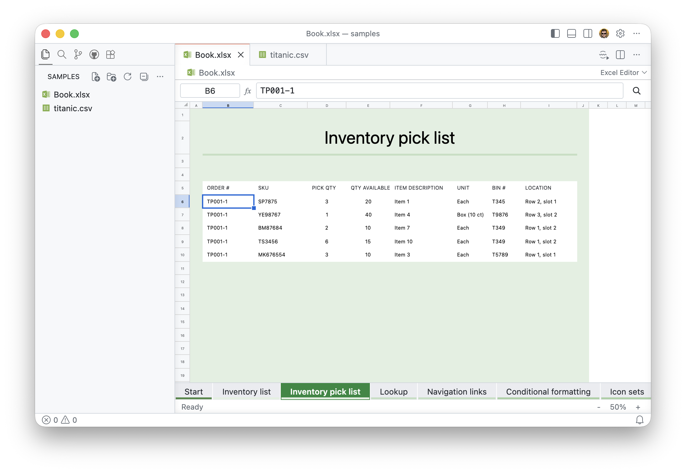
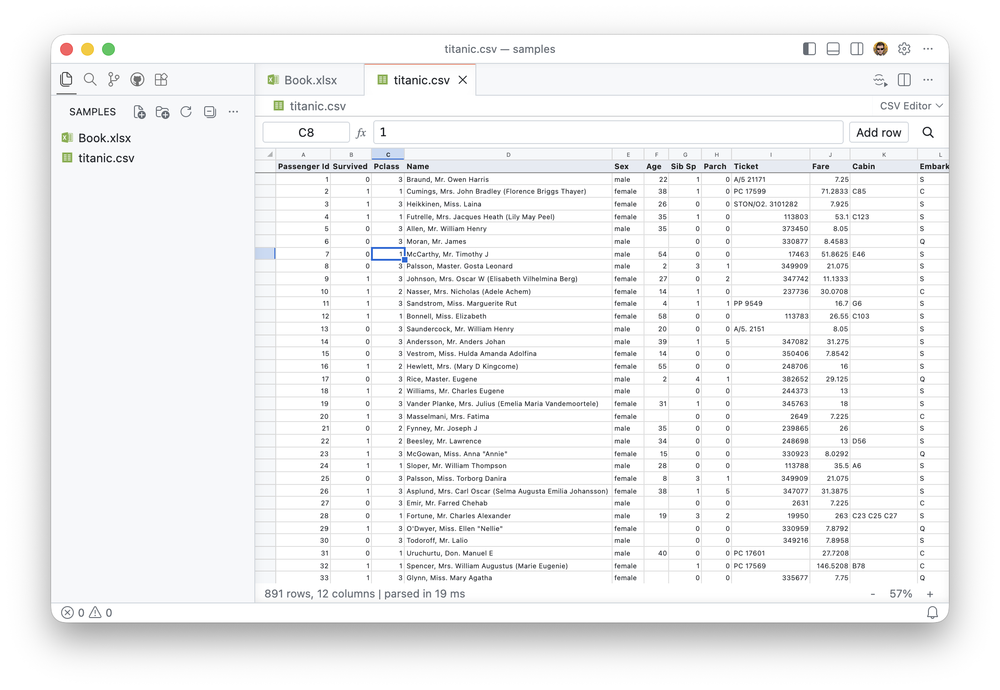

# OpenXL Viewer

[](https://marketplace.visualstudio.com/items?itemName=ilypopv.openxlviewer)
[](https://marketplace.visualstudio.com/items?itemName=ilypopv.openxlviewer)

View and edit **XLSX, CSV and TSV** files right inside VS Code, in a fast canvas-based spreadsheet grid that stays smooth on very large files. XLSX files are read by a built-in reader and saved by patching the original file, so styles, charts, drawings and conditional formatting you did not touch are kept as they are.

## Screenshots

**Excel Editor**: sheet tabs, cell styles, merged cells, frozen panes, number formats, formula bar.



**CSV Editor**: header row, live selection statistics, sorting and filtering, edits written straight into the text file.



## Install

The extension is available in the Visual Studio Marketplace:
[**ilypopv.openxlviewer**](https://marketplace.visualstudio.com/items?itemName=ilypopv.openxlviewer).

- In VS Code open Extensions (`Ctrl/Cmd+Shift+X`) and search for **OpenXL Viewer**, or
- press `Ctrl/Cmd+P` and run `ext install ilypopv.openxlviewer`.

From source:

```bash
git clone https://github.com/ilypopv/openxlviewer.git
cd openxlviewer
npm install
npm run package
code --install-extension openxlviewer.vsix --force
```

Then run `Developer: Reload Window`.

If you have the older "Spreadsheet Viewer" extension installed, disable it: both would compete for `.xlsx` and `.csv` files.

## Usage

- **XLSX / XLSM** open in the Excel Editor by default: sheet tabs, cell styles, merged cells, frozen panes, number formats, hyperlinks (Ctrl/Cmd+click opens http, https and mailto links). Edit a cell by typing or F2; Enter commits, Alt+Enter inserts a newline, Esc cancels. Typed formulas are stored and recalculated live by a built-in engine (about 150 functions); cached values are written with the file and Excel recomputes on open. Undo/redo and Save go through VS Code. If saving fails you get an error and the document stays unsaved. `Excel: Open Preview` opens a read-only view.
- **CSV / TSV / TAB**: run `CSV: Open Preview` (explorer or editor title menu, or `Shift+Cmd/Ctrl+V`) for a read-only view, or `Open With...` and pick `CSV Editor` to edit. Edits are written straight into the text document, so undo, save and diff work as for any text file. `Add row` appends a row; right-click a row number to delete rows.
- Both: copy/paste (TSV), fill down/right, find (Ctrl/Cmd+F), go to cell via the name box (Ctrl/Cmd+G), formula bar, selection statistics (sum, average, count, min, max), zoom (Ctrl/Cmd+wheel), column and row resizing, autosize by double-click. Right-click a column header to sort or filter; sorting and filtering only change the view, never the file.
- `CSV: Clear Preview State` forgets the saved zoom, scroll position and selection of the active preview.

## How it works

- The grid is drawn on a canvas, so very large sheets scroll smoothly. Sorting, filtering and find are time-sliced and never change the file.
- XLSX is read by an own streaming reader and saved by an own patcher that rewrites only the edited cells and keeps every other part of the package (styles, charts, drawings, conditional formatting, data validation) byte for byte.
- CSV/TSV use a byte index over the text; edits are written into the text document as line edits, so undo, save and diff work as usual. Files over 4M characters are streamed to the view in chunks.
- Formulas: about 150 functions (math, text, logical, lookup, date, statistics, financial basics) recalculate when a precedent changes.
- Bundled third-party code: fflate (MIT) and SSF (Apache-2.0).

## Limitations

- No structural row/column insert or delete in XLSX, no chart/image/conditional-format/validation editing (they are preserved).
- Array formulas (including dynamic arrays such as FILTER or SORT) are shown with their cached results and are not recalculated or spilled: after editing a precedent the status bar warns that the results update when the file is opened in Excel. Defined names, structured table references and 3D references evaluate to errors.
- Text is read as en-US for number and date parsing.
- Unsaved edits are never discarded by `CSV: Refresh` or `CSV: Clear Preview State`; save or revert first. If an XLSX changes on disk, a clean editor reloads it and a modified one offers to revert.
- Work on a copy of important files.

## Settings

`csv-preview.separator`, `quoteMark`, `hasHeaders`, `capitalizeHeaders`, `resizeColumns` (`all`/`first`/`none`), `lineNumbers` (`none`/`ordinal`/`source`), `commentCharacter`, `skipComments`, `formatValues` (`always`/`never`/`unquoted`), `numberFormat` (optional .NET-style display format such as `n2`; empty by default, which shows numbers unchanged), and `openStdin`.

## Development

- `npm run compile` / `npm run watch` builds the extension host into `dist/`.
- Press F5 ("Launch Extension") to debug, then open any CSV/XLSX file in the new window.
- Webview code is plain JavaScript in `out/` (no build step); `npm test` runs the unit tests.
- Screenshots for this README live in `docs/images/` and are excluded from the extension package.
